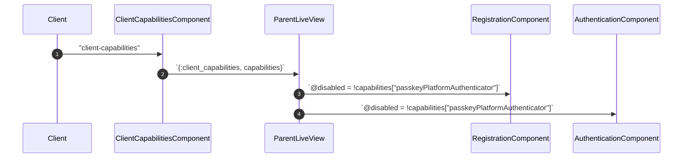
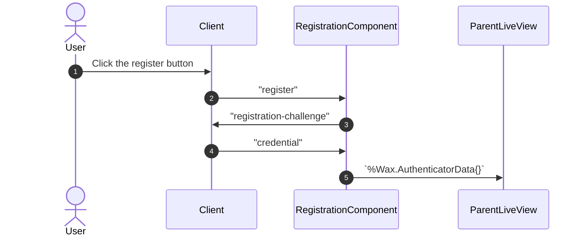
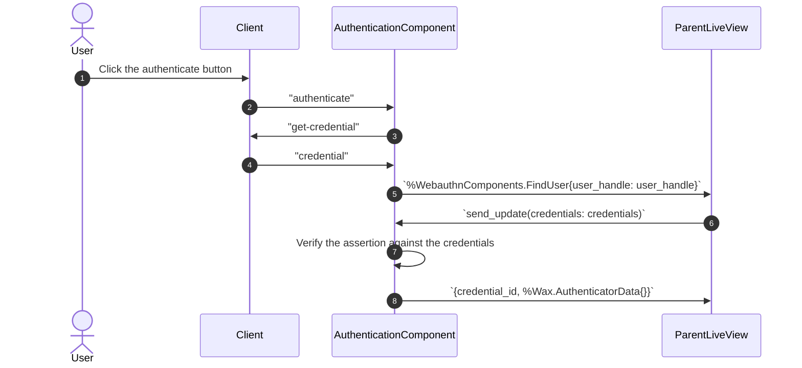

# WebAuthn Flows

`WebauthnComponents` provides modular LiveComponents for detecting Passkey support, registering credentials, and authenticating existing users. See each component's module documentation for assigns, events, and messages.

> The diagrams below illustrate the success path only. Error handling is described in the module documentation for each component.

## Client Capabilities

On mount, the client checks browser support with `PublicKeyCredential.getClientCapabilities()` and reports the result to the parent LiveView. The parent may use this to disable components in unsupported browsers.

## Registration

A user creates a new credential, whether for a new account or an additional Passkey on an existing account.

When the parent LiveView receives the `%Wax.AuthenticatorData{}` message, it must persist the user's new credential. The `:attested_credential_data` field contains the `:credential_id` and `:credential_public_key` required for future authentication. See `WebauthnComponents.RegistrationComponent` for a schema example.

User session management is handled by the host application.

## Authentication

A user signs in to an existing account.

When the parent LiveView receives the `%WebauthnComponents.FindUser{}` message, it must locate the user by `:user_handle`, apply any relevant validation (for example, an account-status check), and send the user's credentials back with `Phoenix.LiveView.send_update/3`. The component then verifies the client's assertion and reports the result. See `WebauthnComponents.AuthenticationComponent` for a complete example.

User session management is handled by the host application.
